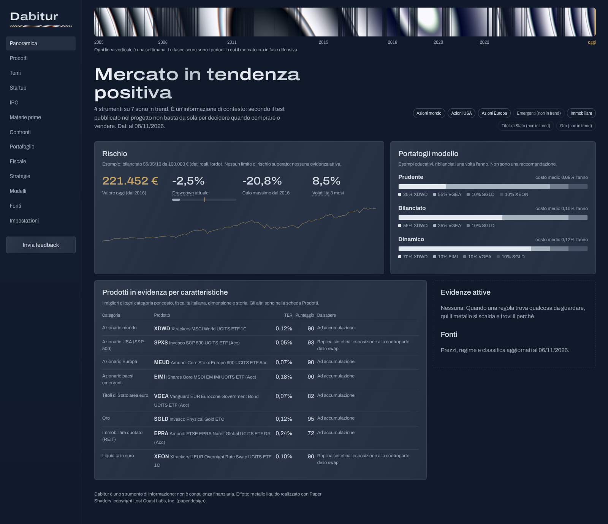

# Dabitur

> Il punto focale di tutte le informazioni rilevanti per decidere *se, cosa e quanto* investire.
> Nome in codice del repository: DTH (Dashboard Trading Help).
> Non un oracolo: un cruscotto di contesto, rischio e strategie validate.

Dabitur è un'**applicazione desktop per Windows** (Tauri + backend Python incluso) che riunisce dati
di mercato, macro, notizie, temi (immobiliare, ETF, indici, crypto, materie prime), startup, IPO
e posizioni dei portali di trading in una dashboard unica. Usa modelli per serie storiche
(TimesFM, Chronos, Kronos…) come strumenti di contesto, un LLM opzionale con l'account
dell'utente, e **si colora solo quando una regola esplicita trova qualcosa da considerare**.

## Installazione su Windows

> Serve Windows 10 o 11 a 64 bit; non serve installare altro. L'app pesa circa 150 MB una volta
> installata e non chiede la password di amministratore.

### 1. Scarica l'installer

1. Apri la pagina [Releases](https://github.com/GODENERGON/Dashboard-Trading-Help---DTH/releases).
2. Nell'ultima versione, sotto **Assets**, scarica il file **`Dabitur-Setup-….exe`**
   (per esempio `Dabitur-Setup-0.1.0.exe`).

Il browser potrebbe avvisarti che il file "non viene scaricato comunemente". È normale per
un'app nuova e senza certificato.
- **Edge:** passa il mouse sul download, clicca sui tre puntini **…** → **Mantieni** →
  **Mostra altro** → **Mantieni comunque**.
- **Chrome:** clicca **Mantieni** (o **Scarica comunque**) nell'avviso del download.

### 2. Avvia l'installazione e supera l'avviso di Windows

1. Fai doppio clic sul file `Dabitur-Setup-….exe` scaricato.
2. Comparirà una finestra blu **"Windows ha protetto il PC"**. Succede perché l'app non ha
   ancora un certificato di firma a pagamento, non perché sia pericolosa.
3. Clicca **Ulteriori informazioni** (il link sotto il testo).
4. Clicca **Esegui comunque**.
5. Segui l'installazione con **Avanti** fino a **Fine**.

Dabitur compare nel menu Start.

### Se Windows blocca l'app senza il pulsante "Esegui comunque"

Su alcuni PC con Windows 11 è attivo **Smart App Control**, che blocca le app senza firma e non
offre il pulsante per proseguire. In quel caso:
1. Apri **Impostazioni** → **Privacy e sicurezza** → **Sicurezza di Windows** →
   **Controllo app e browser**.
2. Apri **Impostazioni di Smart App Control** e scegli **Disattivato**.
3. Ripeti il passo 2.

⚠️ Su alcune versioni di Windows, Smart App Control non si può riattivare senza reinstallare il
sistema. Se preferisci non disattivarlo, scrivimi: aspettiamo la versione firmata.

### Primo avvio, aggiornamenti, disinstallazione

- Al primo avvio una breve guida in tre passi spiega come leggere la schermata. Non servono
  account né chiavi: l'app parte con i prezzi già inclusi e poi li aggiorna da internet da sola.
- Il primo avvio può richiedere una decina di secondi: Windows controlla i file dell'app.
- Le nuove versioni, per ora, si installano scaricando di nuovo il file dalla pagina Releases e
  aprendolo: sostituisce la versione precedente e mantiene i tuoi dati.
- Per lasciare un commento usa il pulsante **Invia feedback** in basso a sinistra.
- Per disinstallare: **Impostazioni** → **App** → **App installate** → **Dabitur** → **Disinstalla**.
  I dati restano nella cartella `%LOCALAPPDATA%\Dabitur`, che puoi cancellare a mano.

## Principi non negoziabili

1. **Nessun modello è un oracolo.** LLM e modelli per serie storiche (TimesFM, Chronos…) sono
   *strumenti di ricerca e di contesto*, non generatori di segnali. Entrano nel sistema solo se
   battono una baseline semplice in walk-forward.
2. **Il rischio viene prima del rendimento.** Dimensionamento, drawdown massimo, esposizione:
   sono la parte centrale della dashboard, non un'appendice.
3. **Niente lookahead, niente overfitting.** Ogni segnale passa l'harness anti-lookahead e una
   validazione walk-forward con costi realistici prima di comparire in UI.
4. **Dati prima dei modelli.** Qualità, freschezza e tracciabilità del dato sono monitorate e
   visibili.
5. **Paper prima del live.** L'esecuzione automatica è l'ultima milestone, dietro gate espliciti
   (vedi [`docs/RISK_POLICY.md`](docs/RISK_POLICY.md)). I connettori ai portali sono in sola lettura.
6. **Informazione ≠ segnale.** Notizie, startup, IPO e forecast informano; solo le strategie
   validate producono pesi. Ogni colore in UI è spiegato dalla regola che l'ha acceso.

## Mappa della documentazione

| Documento | Contenuto |
|---|---|
| [`docs/VISION.md`](docs/VISION.md) | Perché esiste, per chi, cosa non è |
| [`docs/MODULES.md`](docs/MODULES.md) | Catalogo dei pannelli/informazioni della dashboard |
| [`docs/DATA_SOURCES.md`](docs/DATA_SOURCES.md) | Fonti dati, costi, limiti, licenze |
| [`docs/ARCHITECTURE.md`](docs/ARCHITECTURE.md) | Architettura, flussi, contratti tra i layer |
| [`docs/VALIDATION.md`](docs/VALIDATION.md) | Come si valida un segnale (harness walk-forward) |
| [`docs/RISK_POLICY.md`](docs/RISK_POLICY.md) | Guardrail su rischio ed esecuzione |
| [`docs/DESIGN.md`](docs/DESIGN.md) | Direzione visiva "sala controllo in metallo liquido" |
| [`docs/PRODUCTS.md`](docs/PRODUCTS.md) | Classifica prodotti per caratteristiche e portafogli modello |
| [`docs/TOOLS.md`](docs/TOOLS.md) | Strumenti open source valutati |
| [`docs/ROADMAP.md`](docs/ROADMAP.md) | Milestone e criteri di uscita |
| [`docs/OPEN_QUESTIONS.md`](docs/OPEN_QUESTIONS.md) | Decisioni aperte prima della costruzione |
| [`docs/adr/`](docs/adr/) | Architecture Decision Records |
| [`CLAUDE.md`](CLAUDE.md) | Regole operative per gli agenti AI che lavorano sul repo |



## Struttura del repository

```
backend/            Pacchetto Python `dth` (API, ingestione, segnali, backtest, rischio)
  src/dth/
    core/           Config, tipi di dominio
    providers/      Adattatori fonti dati (contratto DataProvider)
    store/          Persistenza (DuckDB + Parquet)
    signals/        Segnali (contratto Signal, no-lookahead)
    forecast/       Forecaster (baseline + adattatori TSFM opzionali)
    backtest/       Harness walk-forward e metriche
    risk/           Sizing e limiti di rischio
    alerts/         Notifiche
    api/            FastAPI
  tests/            Test unitari + harness anti-lookahead
frontend/           Interfaccia React (stile metallo liquido)
  src-tauri/        Shell desktop Tauri: avvia il motore Python e crea l'installer
config/             Universo, registro fonti, regole di evidenza, alert (esempi)
docs/               Documentazione di progetto
```

## Avvio rapido (sviluppo)

```bash
make install        # crea venv e installa backend in modalità sviluppo
make test           # test + harness anti-lookahead
make lint           # ruff
make api            # avvia il motore su http://127.0.0.1:8765 (docs su /docs)
cd frontend && npm run dev          # interfaccia nel browser, collegata al motore
cd frontend && npm run tauri dev    # app desktop in sviluppo (serve Rust)
make backtest       # esegue un walk-forward di esempio su dati sintetici
# studio su dati reali (serve internet): python -m dth.cli ucits-trend
# oppure da GitHub: Actions → research → Run workflow
```

`docker-compose.yml` serve solo per lo sviluppo (il NUC è fuori perimetro, ADR 0007).

## Stato

**Fase 0 — Harness** completata. Strategie testate su dati reali, nessuna validata al netto
delle tasse finora: [trend multi-asset](docs/research/2026-11-06-ucits-trend.md),
[core-satellite e regime](docs/research/2026-11-06-core-satellite-results.md) (pre-registrati).

**M1, prima versione installabile**: installer Windows costruito da GitHub Actions
(`windows-release`, a ogni tag `v*`), Panoramica e Prodotti con dati reali, aggiornamento
automatico dei prezzi, guida al primo avvio, feedback. Le altre sezioni arrivano da M2.

## Disclaimer

Software sperimentale. Nulla di ciò che produce costituisce consulenza finanziaria.
Il trading comporta il rischio di perdere capitale.
