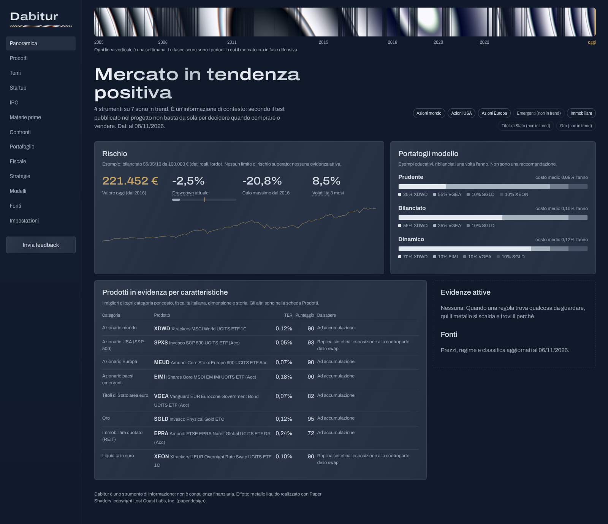

# Frontend Dabitur

Prototipo dell'interfaccia (React + TypeScript + Vite) nello stile "sala controllo in metallo
liquido" ([`../docs/DESIGN.md`](../docs/DESIGN.md)). In M1 verrà incluso nella shell Tauri
([ADR 0003](../docs/adr/0003-windows-desktop-app-with-tauri.md)).



```bash
npm ci
npm run dev      # http://localhost:5173
npm run build    # controllo tipi + build di produzione
```

## Dati del prototipo

`src/data/*.json` contiene dati **reali** esportati dal backend, non inventati:

```bash
cd ../backend
python -m dth.cli demo-data --prices-csv <prices_eur.csv dello studio research>
```

In M1 questi file saranno sostituiti dalle chiamate all'API locale (`/regime/trend`,
`/products`, `/portfolios/models`) con tipi generati dallo schema OpenAPI.

## Regole di design applicate

- Colore solo dalle regole di evidenza (ADR 0004): oggi nessuna è attiva, quindi l'interfaccia
  è in toni metallici neutri. L'oro è riservato al denaro dell'utente.
- Metallo liquido (Paper Shaders) solo nella banda di regime e nel logo; `prefers-reduced-motion`
  ferma l'animazione.
- Ogni termine tecnico ha una spiegazione al passaggio del mouse.
